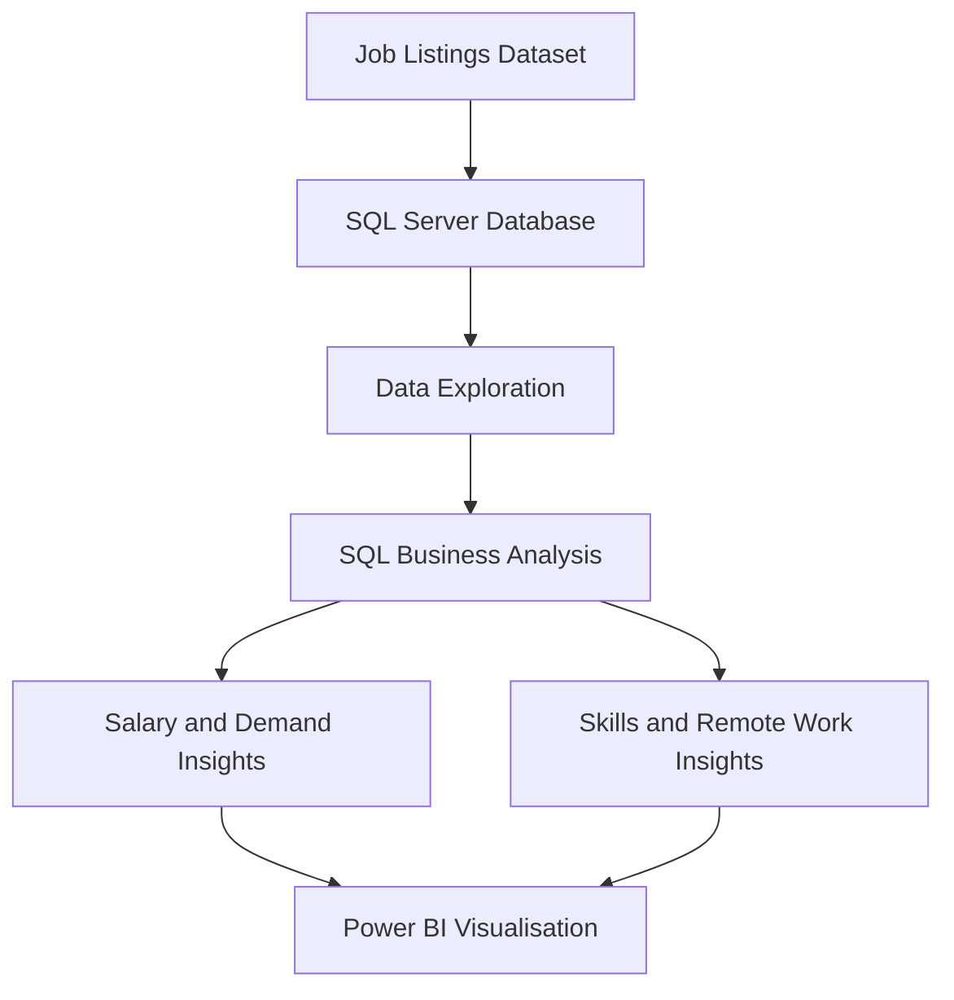

# 📊 Data Jobs Market Analysis&#x20;

## Project Overview

This project explores job market data using **Microsoft SQL Server** to investigate job demand, salary trends, technical skills, and remote-work opportunities.

The goal is to answer practical business questions using SQL and present insights that can help job seekers better understand the data job market.

## 🎯 Business Questions

| # | Business Question                                         | Analysis                |
| - | --------------------------------------------------------- | ----------------------- |
| 1 | Which data job roles have the most postings?              | Job demand              |
| 2 | Which job roles have the highest average annual salaries? | Salary analysis         |
| 3 | Which technical skills are most frequently requested?     | Skills demand           |
| 4 | Which job roles offer remote-work opportunities?          | Remote-work analysis    |
| 5 | Which countries have the most job postings?               | Geographic distribution |
| 6 | How do data job roles rank by average salary?             | Advanced SQL analysis   |

## 🛠️ Tools & Technologies

- **Microsoft SQL Server Management Studio (SSMS)** — querying and analysing data.
- **SQL** — data aggregation, filtering, ranking, and analysis.
- **Common Table Expressions (CTEs)** — organising complex queries into readable steps.
- **Window Functions** — ranking job roles by average annual salary.
- **Power BI** — visualising job market findings.

## 📈 Analysis Workflow

## 🔍 SQL Analysis

The project includes six SQL queries:

1. `01_Most_In_Demand_Data_Job_Roles.sql`
2. `02_Highest_Paying_Data_Job_Roles.sql`
3. `03_Most_In_Demand_Technical_Skills.sql`
4. `04_Remote_Work_Opportunities_By_Role.sql`
5. `05_Job_Postings_By_Country.sql`
6. `06_Rank_Job_Roles_By_Salary.sql`

The queries demonstrate:

- Aggregations using `COUNT()` and `AVG()`.
- Grouping and filtering using `GROUP BY`, `WHERE`, and `HAVING`.
- Ranking results with `ORDER BY` and `RANK()`.
- Breaking down analysis using multiple CTEs.
- Applying window functions to compare salary rankings.
- Splitting skill lists into individual values for analysis.

## 📊 Power BI Dashboard

The Power BI report is designed to answer business questions through simple, focused visualisations.

Planned visuals include:

- Most in-demand data job roles.
- Average annual salary by job role.
- Most requested technical skills.
- Remote-work availability by job role.
- Total job postings.

> Dashboard screenshots will be added here once the report is finalised.

##  Business Value

This analysis can help job seekers explore which data job categories appear most frequently, compare advertised salary levels, identify frequently requested technical skills, and understand remote-work availability.

The results describe the dataset analysed and should not be interpreted as a complete representation of the entire job market.

##  Skills Demonstrated

- SQL querying and data exploration
- Business-question-driven analysis
- Salary and job-demand comparisons
- CTEs and window functions
- Data preparation for visualisation
- Communicating findings through Power BI

## 👩🏽‍💻 About This Project

This is a personal data analytics portfolio project developed to strengthen my SQL skills and practise turning job market data into useful business insights.

